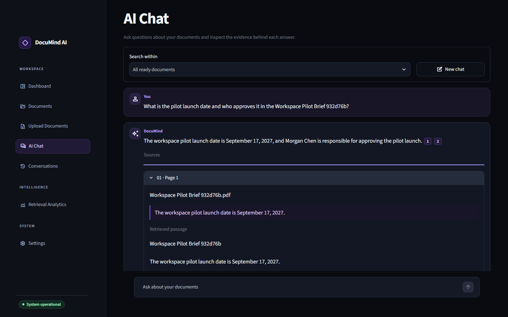
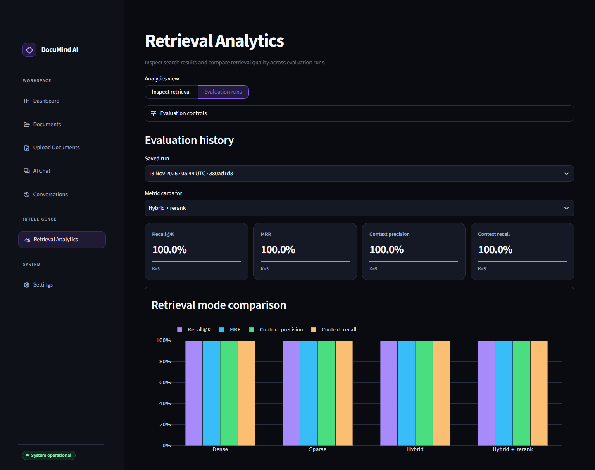
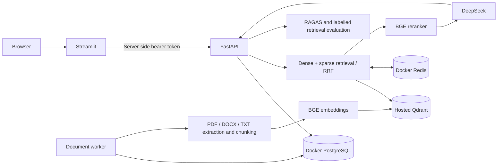

# DocuMind AI

DocuMind AI turns PDF, DOCX, and TXT files into a searchable document workspace. It combines dense and sparse retrieval with cross-encoder reranking, generates cited answers through DeepSeek, and persists documents, conversations, and evaluation runs in PostgreSQL.

## Features

- Upload multiple documents and monitor extraction and indexing jobs. Search, filter, retry, or remove files in the document library.
- Run dense, sparse, or hybrid retrieval with optional cross-encoder reranking. Inspect candidate scores, final ranks, and latency.
- Ask questions over selected documents and open citations linked to PDF pages, DOCX blocks, or TXT line ranges.
- Reopen saved conversations and compare four retrieval modes using the bundled evaluation dataset.
- Check PostgreSQL, Redis, Qdrant, and DeepSeek status from a local Streamlit workspace.

## Application screenshots

These screenshots use the demo handbook and a synthetic pilot brief. The scores come from the small bundled demo evaluation.

| Cited conversation | Retrieval evaluation |
| --- | --- |
|  |  |

## Technology stack

| Layer | Technologies |
| --- | --- |
| Workspace and API | Python 3.11, Streamlit, FastAPI, Pydantic, Uvicorn, Plotly |
| Ingestion | PyMuPDF, python-docx, LangChain text splitters |
| Retrieval and generation | Hosted Qdrant, Sentence Transformers BGE embeddings and cross-encoder, DeepSeek |
| Data and evaluation | PostgreSQL, SQLAlchemy, Alembic, Redis, RAGAS |
| Tooling | Docker Compose, pytest |

## Local installation

Clone or download the repository and open a terminal at its root. Install Docker Engine and Docker Compose, or start Docker Desktop in Linux-container mode on Windows. You need a hosted Qdrant cluster, a DeepSeek API key, network access to the container registry and Hugging Face, and room for the CPU model weights and container images. The backend loads both models on demand and stores their pinned downloads in a Docker volume.

### Environment configuration

```powershell
docker info
docker compose version
if (-not (Test-Path .env)) { Copy-Item -LiteralPath .env.example -Destination .env }
```

On macOS or Linux, copy `.env.example` to `.env` with `cp .env.example .env` on first setup. Fill in the blank values below in your local `.env`. Git and the Docker build context exclude this file.

| Variable | Value |
|---|---|
| `POSTGRES_PASSWORD` | A strong random password for the Docker PostgreSQL user. Set this before the first startup. |
| `SECRET_KEY` | A separate random workspace key with at least 32 printable ASCII characters and no spaces. Compose mounts it as a server-side secret for Streamlit. Use it as the bearer token only for direct API requests. |
| `QDRANT_URL` | The HTTPS cluster endpoint from the hosted Qdrant dashboard. Copy its port as supplied by the host, if any. |
| `QDRANT_API_KEY` | A hosted cluster/database key with permission to create the dedicated collection, index payload fields, search, write, and delete vectors. |
| `DEEPSEEK_API_KEY` | An API key from the DeepSeek platform. Enable access and billing for the selected model. |

Use an unused collection name in `QDRANT_COLLECTION_NAME` for this workspace. The first upload creates it with named dense and sparse vectors. An existing collection must match the expected schema and model signature. `DEEPSEEK_BASE_URL` defaults to the OpenAI-compatible HTTPS endpoint and `DEEPSEEK_MODEL` defaults to `deepseek-flash`. See the providers’ setup docs for where to obtain credentials. [Qdrant Cloud authentication](https://qdrant.tech/documentation/cloud/authentication/) [DeepSeek first API call](https://api-docs.deepseek.com/)

### Docker setup

```powershell
docker compose config --quiet
docker compose up -d --build --wait
docker compose ps
```

| Service | Default address |
|---|---|
| Streamlit | [http://localhost:8501](http://localhost:8501) |
| API | [http://localhost:8000](http://localhost:8000) |
| Swagger UI | [http://localhost:8000/docs](http://localhost:8000/docs) |
| Readiness | [http://localhost:8000/health/ready](http://localhost:8000/health/ready) |

The UI and API ports bind to IPv4 loopback. Use `FRONTEND_PORT` and `BACKEND_PORT` if those host ports are in use. The backend runs Alembic before serving HTTP. Docker PostgreSQL and Redis are accessible on the Compose network at `postgres:5432` and `redis:6379`. Neither database publishes a host port. Windows PostgreSQL can be stopped or used by other projects independently.

Running `docker compose down` stops the application and preserves its volumes. When settings change, run `docker compose up -d --build --wait` to recreate affected services. PostgreSQL reads `POSTGRES_PASSWORD` when initializing an empty volume. To change it after first startup, rotate the existing database user's password and update the environment together.

## Configuration reference

- **PostgreSQL and Redis** — Keep `DATABASE_URL` blank to derive it from `POSTGRES_DB`, `POSTGRES_USER`, and `POSTGRES_PASSWORD`. To supply it explicitly, use the `postgresql+psycopg` driver, an encoded password, and `postgres:5432`. The API rejects host addresses such as `localhost`. `REDIS_URL` defaults to `redis://redis:6379/0`. `EMBEDDING_CACHE_TTL_SECONDS=0` disables the cache. Redis caches query embeddings keyed by the embedding signature and a hash of the query. Each retrieval still applies the live document filter.
- **Model and retrieval** — `EMBEDDING_MODEL` defaults to `BAAI/bge-small-en-v1.5`, and `RERANKER_MODEL` defaults to `BAAI/bge-reranker-base`. The defaults have pinned Hugging Face commits. Set `EMBEDDING_REVISION` or `RERANKER_REVISION` to a 40-character commit when changing the corresponding model ID. Choose a Sentence Transformers-compatible encoder or cross-encoder with safetensors weights. `RERANK_ENABLED`, `RETRIEVAL_TOP_K`, `RERANK_TOP_K`, `DENSE_MIN_SCORE`, and `EMBEDDING_BATCH_SIZE` control search depth and CPU work. Changing the embedding model or revision requires a new index and re-upload from originals. To migrate the same workspace, remove the old documents using the original collection configuration before switching.
- **Uploads** — `MAX_UPLOAD_SIZE_MB` is a per-file limit, in MiB. `MAX_UPLOAD_FILES` controls each request's file count. The total HTTP body is limited to twice the per-file limit plus 1 MiB for multipart overhead. Streamlit batches larger selections automatically. `CHUNK_SIZE` and `CHUNK_OVERLAP` are character counts and apply to new indexing jobs.
- **Generation** — `DEEPSEEK_TEMPERATURE` adjusts answer sampling, and `DEEPSEEK_TIMEOUT_SECONDS` controls the provider request timeout. The API and System Settings report missing provider credentials.
- **Application** — `APP_NAME`, `APP_ENV`, `LOG_LEVEL`, and `DEBUG` control API naming, environment labeling, and logger verbosity. `CORS_ORIGINS` is a JSON list of approved origins and defaults to empty. The Compose frontend makes server-side API calls through `http://backend:8000`. `BACKEND_URL` applies when launching Streamlit outside Compose.

## Architecture



Uploads queue bytes in PostgreSQL. A worker claims jobs under a PostgreSQL advisory lock, extracts text and source locations, and recursively splits passages with LangChain. It writes stable chunk IDs to Qdrant and frees the uploaded bytes once indexing succeeds. Failed uploads retain their bytes for retry. Deletion removes vectors before deleting the document record, and documents being deleted are immediately excluded from new retrieval scopes. If an indexing process stops during a write, the next attempt clears partial vectors and reindexes the document.

PyMuPDF preserves original PDF page numbers, python-docx uses paragraph/block and table-row locations, and TXT uses original line ranges. SHA-256 detects exact duplicate uploads. Sentence Transformers creates normalized dense embeddings. Sparse retrieval uses case-folded lexical tokens, deterministic IDs, BM25-style local term weights, and Qdrant's collection-level IDF. Exact identifiers such as `FIN-115` are retained as tokens. Qdrant fuses dense and sparse ranks using reciprocal rank fusion. The BGE cross-encoder reranks the candidate set on CPU.

Answer generation separates instructions from untrusted excerpts and asks for a structured, evidence-linked response. The backend verifies each source number and quoted excerpt against the retrieved text before returning citations. PostgreSQL keeps conversation turns and their historical citation snapshots. Follow-ups can be rewritten using previous user questions. The provider interface lets the answer layer use another compatible LLM without changing retrieval.

## Use the application

1. Open the Streamlit URL to enter the local workspace. In **Settings**, use **Check hosted services** to check Qdrant and DeepSeek model access. The Streamlit server authenticates its own API calls, and Compose publishes both web ports on loopback for personal use.
2. Upload files under **Upload Documents**. Watch **Document Library** for Ready or Failed, and use its Manage action to retry or remove a document.
3. Open **AI Chat** and ask a question. Select ready documents to restrict retrieval. Expand sources to inspect exact quotes and their locations. Open an earlier thread under **Conversation History** to continue it.
4. Use **Retrieval Analytics** to compare candidate and final ranks, scores, cache hits, and stage timings. For evaluation, download the provided handbook from that page, upload the downloaded copy, wait for Ready, and run the demo. The API also accepts custom labelled cases and explicit document IDs.

### Evaluation

The demo has four labelled questions with reference answers and verbatim evidence spans. A run compares dense, sparse, hybrid, and hybrid with reranking at the same final K. Recall@K and Context Recall both count unique labelled evidence spans found by K in this dataset. MRR uses the reciprocal rank of the first relevant chunk. Context Precision averages the precision at each relevant rank. Results include the retrieved chunk IDs and elapsed time and are saved in PostgreSQL.

Optional answer scoring makes paid DeepSeek calls for each mode and question. RAGAS Faithfulness measures whether the answer's claims are supported by the retrieved excerpts. Answer Relevance uses the similarity between the original question and questions generated from the answer. Averages use the available scores and each case records abstention or judge failure. Enable scoring on a small run first. [RAGAS Faithfulness](https://docs.ragas.io/en/stable/concepts/metrics/available_metrics/faithfulness/)

## API documentation

Health and OpenAPI endpoints are public on the loopback interface. All `/api/v1` routes require `Authorization: Bearer <SECRET_KEY>`. In Swagger UI use **Authorize** to provide the workspace key.

| Method and path | Purpose |
|---|---|
| `GET /health/live`, `GET /health/ready` | Process health and migrated PostgreSQL availability |
| `GET /api/v1/dashboard`, `GET /api/v1/settings?check_external=true` | Statistics and service diagnostics |
| `POST /api/v1/documents` | Submit multipart uploads using repeated `files` fields |
| `GET /api/v1/documents`, `GET /api/v1/documents/{id}` | List documents or poll one job |
| `POST /api/v1/documents/{id}/retry`, `DELETE /api/v1/documents/{id}` | Retry failed ingestion or queue removal |
| `POST /api/v1/retrieval`, `POST /api/v1/chat` | Inspect retrieval or generate and persist a cited answer |
| `GET` or `POST /api/v1/conversations` | Browse or create conversations |
| `GET` or `DELETE /api/v1/conversations/{id}` | Read paginated history or delete a conversation |
| `GET /api/v1/evaluations/demo`, `GET` or `POST /api/v1/evaluations` | Download test corpus, browse runs, or run evaluation |

Upload and deletion return `202 Accepted` while the job runs. Search and chat accept a question, retrieval strategy, and optional document UUIDs. Omitting document IDs searches the ready workspace; an empty array searches no documents. `401` indicates an invalid workspace key, `413` a body size violation, `422` an invalid input, `502` a provider failure, and `503` an unavailable required service or missing configuration.

## Repository layout and tests

- `documind/` contains configuration, APIs, ingestion, SQLAlchemy models, document jobs, retrieval, generation, and evaluation.
- `backend/` contains the FastAPI Dockerfile, dependencies, and tests. `frontend/` contains the Streamlit app, theme, dependencies, and Dockerfile.
- `migrations/` contains the Alembic schema and revision template. `evaluation/datasets/` contains the handbook and labelled cases.
- `docker-compose.yml` declares the application stack and named volumes. `.env.example` is the shareable configuration template.

For local Python tests on Windows, use the existing `.venv` or create it with `py -3.11 -m venv .venv`. Install the same CPU PyTorch used by Docker before installing backend dependencies.

```powershell
.\.venv\Scripts\python.exe -m pip install torch==2.8.0 --index-url https://download.pytorch.org/whl/cpu
.\.venv\Scripts\python.exe -m pip install -r backend/requirements.txt -r requirements-dev.txt
.\.venv\Scripts\python.exe -m pip check
.\.venv\Scripts\python.exe -m pytest -q backend/tests
```

The suite covers parsing and source locations, invalid uploads, retrieval scope, collection compatibility, citation validation, provider timeouts, metrics, authentication, input validation, and request caps. `backend/tests/docker_contract.py` additionally exercises the upload-to-chat workflow using an isolated Compose database and Redis. To run it, start a separate Compose project with alternate host ports using an ignored environment file, set `APP_ENV=test` and leave hosted credentials blank. Pass that file both as `--env-file` and via its own `DOCUMIND_ENV_FILE` setting. Once the stack is healthy, pipe the script into `docker compose --env-file <test-file> -p <test-project> exec -T backend python -`. It uses an in-process Qdrant index and a deterministic answer provider. Add `-e DOCUMIND_CONTRACT_REAL_MODELS=true` after `exec -T` to run the actual BGE models instead of the deterministic encoder.

## Troubleshooting and deployment boundaries

- **Docker fails before startup** — Check `docker info` and `docker compose ps`. See `docker compose logs --tail 80 backend postgres` for migration and database errors.
- **Qdrant error** — Verify HTTPS cluster URL, key permissions, and collection name. If the hosted cluster has a network allowlist, allow the Docker host’s egress. Use an unused collection for a new embedding signature.
- **Slow first search or upload** — First use downloads and loads the selected model. Subsequent calls reuse the weights. Reranker cost grows with the candidate count. Reduce candidate depth or disable reranking where latency warrants it.
- **No extractable PDF text** — Scanned PDFs require OCR before upload. Password-protected documents and malformed or oversized files return processing errors.
- **Missing or invalid DeepSeek key** — Verify model access in System Settings and recreate the backend after editing `.env`. Source snippets are sent to DeepSeek to answer questions and judge selected evaluations. Hosted Qdrant stores embeddings and passage text.

This deployment is a single shared workspace intended for a trusted operator on localhost. Exposing it to multiple users would require individual identities and authorization, TLS termination, and deployment-specific resource controls. Citation checks verify quoted text and source references, while semantic entailment and prompt-injection resistance still need evaluation on the intended corpus. Removing a document clears its vectors and metadata. Existing conversation snapshots and saved evaluation reports remain until those records are removed. Streaming and OCR are outside the current implementation.
